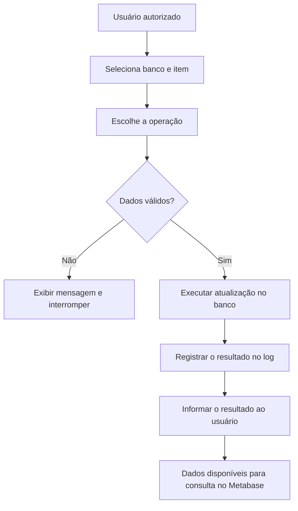

# Atualizador de Produção

**Atualizações operacionais simples, rastreáveis e acessíveis para o processo produtivo.**

Aplicação desktop em Python para atualizar registros de produção por meio de uma interface gráfica, sem exigir que o usuário conheça SQL ou Python.

---

## Sumário

1. [Visão geral](#visão-geral)
2. [Objetivos](#objetivos)
3. [Funcionalidades](#funcionalidades)
4. [Tecnologias e integrações](#tecnologias-e-integrações)
5. [Fluxo de operação](#fluxo-de-operação)
6. [Pendências prioritárias](#pendências-prioritárias)
7. [Próximas melhorias](#próximas-melhorias)
8. [Segurança e confiabilidade](#segurança-e-confiabilidade)
9. [Histórico de alterações](CHANGELOG.md)

## Visão geral

O **Atualizador de Produção** simplifica a atualização de informações relacionadas à finalização de máquinas e itens do processo produtivo.

A ferramenta permite que usuários autorizados realizem operações por uma interface gráfica. O objetivo é reduzir a necessidade de alterações manuais no banco de dados e contribuir para a consistência das informações utilizadas em relatórios e painéis do **Metabase**.

## Objetivos

- Simplificar a finalização e o cancelamento de itens.
- Permitir alterações de estado conforme as opções disponíveis no banco selecionado.
- Registrar complementos e previsões associados aos itens.
- Manter um histórico das operações realizadas pelos usuários.
- Apoiar a consistência dos dados consumidos pelo Metabase.
- Facilitar a manutenção e a evolução da aplicação.

## Funcionalidades

### 1. Aba Finalizar

| Ação | Comportamento |
| --- | --- |
| **Finalizar** | Atualiza o status e a data de término do item. |
| **Cancelar** | Reverte o status e remove a informação de término. |
| **Complemento** | Permite informar dados adicionais relacionados ao item. |

### 2. Aba Estado

Permite alterar o estado de um registro usando os estados disponíveis no banco selecionado.

- Carrega os estados disponíveis de acordo com a seleção.
- Permite escolher o novo estado pela interface.
- Envia a atualização ao banco de dados.

### 3. Aba Comentários

Permite atualizar os campos de complemento e previsão associados ao registro.

> **Atenção:** a disponibilidade depende das colunas existentes na tabela selecionada. A validação de compatibilidade entre bancos e colunas ainda está pendente.

### 4. Histórico de operações

A aplicação possui recursos para identificar o usuário e registrar operações de finalização em uma tabela de log no PostgreSQL. Também pode exibir os cinco registros mais recentes do usuário ao iniciar.

> **Pendente:** corrigir o registro do comando na tabela de log, para que seja armazenada a operação efetivamente executada, e não apenas o comando de consulta.

## Tecnologias e integrações

| Tecnologia ou componente | Responsabilidade |
| --- | --- |
| **Python** | Linguagem principal da aplicação. |
| **Interface gráfica (GUI)** | Interação por janelas, abas e campos de seleção. |
| **PostgreSQL** | Banco de dados utilizado pela aplicação. |
| `Conexao.py` | Comunicação com o banco de dados. |
| `log_usuario.py` | Identificação do usuário. |
| **PyInstaller** | Geração do executável. |
| **Metabase** | Consumo e visualização dos dados do processo produtivo. |

A aplicação contempla operações relacionadas aos bancos **Pedidos** e **Laser**, incluindo a tabela `plan_laser`. As operações disponíveis dependem da tabela selecionada e das colunas existentes.

## Fluxo de operação

O diagrama abaixo representa o fluxo esperado em alto nível. A implementação real deve ser conferida no código-fonte.

## Pendências prioritárias

As prioridades abaixo são sugestões para organizar a próxima etapa.

| Prioridade | Tarefa | Situação |
| --- | --- | --- |
| Alta | Corrigir o log para registrar a operação executada e seu resultado real. | Concluída |
| Alta | Validar bancos e colunas disponíveis na aba Comentários. | Pendente |
| Média | Testar o cancelamento de itens finalizados. | Pendente |
| Média | Atualizar e validar o executável. | Pendente |
| Média | Melhorar a visualização do histórico do usuário. | Pendente |

## Próximas melhorias

- [ ] Criar consultas de itens por tipo e estado.
- [ ] Restringir os estados conforme as regras de negócio.
- [ ] Ampliar e padronizar as validações.
- [ ] Melhorar o tratamento de erros de conexão e atualização.
- [ ] Aprimorar a auditoria das operações.
- [ ] Revisar a experiência de uso da interface.

## Segurança e confiabilidade

Como a aplicação altera dados diretamente no banco, recomenda-se:

- Validar os dados antes de executar atualizações.
- Utilizar consultas parametrizadas sempre que possível.
- Restringir as permissões do usuário de banco às operações necessárias.
- Registrar usuário, data/hora, item, operação e resultado.
- Não registrar uma operação como concluída quando a atualização falhar.
- Testar novas versões em ambiente controlado antes da distribuição.
- Nunca armazenar senhas ou credenciais diretamente neste arquivo.

## Arquivos de documentação

- [`README.md`](README.md) — visão geral, funcionalidades, tecnologias e pendências.
- [`CHANGELOG.md`](CHANGELOG.md) — histórico de desenvolvimento, alterações e testes.

## Situação atual

O projeto evoluiu de uma ferramenta simples de finalização para uma aplicação com recursos de alteração de estado, complementos, previsões e registro de operações.

**Foco atual:** consolidar as validações da aba Comentários, corrigir a gravação dos logs e concluir os testes das funcionalidades existentes antes de ampliar o escopo.
